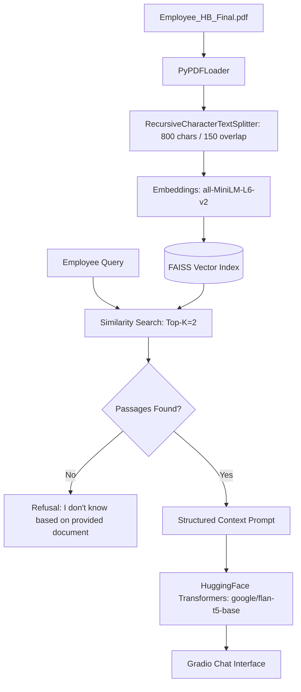

# 🏢 PeopleLoop Remote Work Enablement Assistant

[](https://www.python.org/)
[](https://www.langchain.com/)
[](https://github.com/facebookresearch/faiss)
[](https://huggingface.co/google/flan-t5-base)
[](https://gradio.app/)
[](LICENSE)

> A production-grade **Retrieval-Augmented Generation (RAG)** workplace companion designed for distributed organizations. The assistant grounds answers **strictly within the official Remote Employee Handbook** (`Employee_HB_Final.pdf`), delivering clear, factual support while enforcing negative constraints to prevent hallucinations. Built entirely using open-source, local-first models.

---

## 📌 Problem & Value Proposition

Distributed teams often struggle to navigate dense internal HR documentation, benefit policies, and remote-work guidelines. Traditional search returns disconnected paragraphs without synthesis, while general-purpose commercial LLMs risk hallucinating non-existent company benefits or leaking proprietary HR policies to third-party APIs.

**PeopleLoop Assistant** solves this through:
- **Strict Context Grounding:** The model only generates responses supported by the retrieved document chunks.
- **Deterministic Refusal:** If an employee asks about policies not documented in the handbook, the assistant explicitly states: *"I don’t know based on the provided document."*
- **100% Free & Open-Source:** Runs locally or on Hugging Face Spaces with zero external API fees.

---

## 🛠️ Architecture & Pipeline



### Technical Workflow:
1. **Document Ingestion & Chunking:** Loads and parses `Employee_HB_Final.pdf` using LangChain's `PyPDFLoader`. Text is split into overlapping chunks (size: 800 tokens, overlap: 150 tokens) to preserve semantic continuity across section boundaries.
2. **Dense Vector Embeddings:** Chunks are vectorized using `sentence-transformers/all-MiniLM-L6-v2`, yielding high retrieval accuracy with low computational overhead.
3. **FAISS Similarity Search:** Fast in-memory local vector store (`vectorstore/faiss_index`) with local caching to eliminate re-indexing latency on repeated runs.
4. **Context-Constrained Prompting:** Formats retrieved passages into a structured system prompt directing `google/flan-t5-base` to summarize strictly without speculation.
5. **Interactive UI:** Served via a responsive, mobile-friendly **Gradio Chatbot** with automatic input clearing and session management.

---

## 📂 Project Structure

```text
People-Loop-RAG-Assistant/
├── app.py                   # Core RAG pipeline, LLM inference, and Gradio chat interface
├── Employee_HB_Final.pdf    # Source corporate remote work handbook
├── requirements.txt         # Production dependencies
├── .gitignore               # Ignored cache and vector index files
└── README.md                # Technical documentation
```

---

## 🚀 Quickstart & Local Setup

### 1. Prerequisites
- Python 3.10 or 3.11
- Git

### 2. Installation
```bash
git clone https://github.com/100kuta/People-Loop-RAG-Assistant.git
cd People-Loop-RAG-Assistant

# Create virtual environment
python -m venv .venv
source .venv/bin/activate  # On Windows: .venv\Scripts\activate

# Install dependencies
pip install -r requirements.txt
```

### 3. Run the Assistant
```bash
python app.py
```
The Gradio web interface will launch automatically at `http://127.0.0.1:7860`.

---

## 💬 Sample Evaluation Queries

| Employee Query | Grounded System Behavior |
|---|---|
| *"What is our policy on core working hours?"* | Retrieves remote working hour clause; summarizes expectations clearly. |
| *"How do I claim home office equipment reimbursement?"* | Extracts expense policy and step-by-step submission steps. |
| *"What is the annual paternity leave allowance?"* | Answers strictly if stated in the handbook. |
| *"What is the company stock option vesting schedule?"* | Emits refusal: *"I don’t know based on the provided document."* (Prevents speculation). |

---

## 📜 License

This project is open-source and available under the [MIT License](LICENSE).
